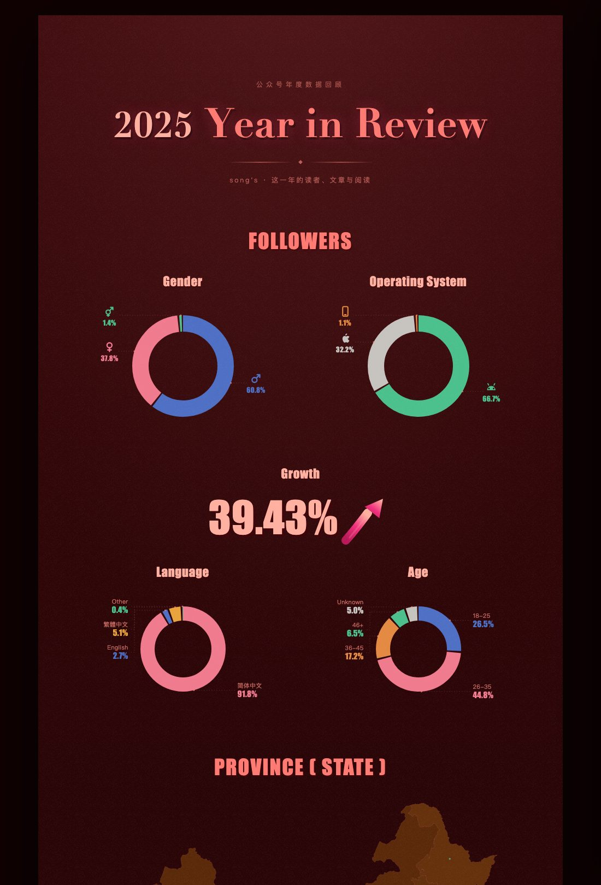

# 公众号年度数据海报 · 数据驱动版

每年都要重做的那种「年度数据长图」。以前靠 PS 一格一格摆，现在只填数字：版式、配色、地图、图表全部自动生成，右下角一键导出图片。



**在线预览**：<https://liarrdev.github.io/annual-data-poster/>

## 特性

- **单文件、纯前端**：`index.html` 双击即开，断网也能用，不依赖任何 CDN 或构建服务
- **双编辑器**：可视化表单 + 原始 JSON，随时切换；表单改完即时重绘
- **6 套深色配色**，按年份自动轮换，也可手动锁定。换主题时数据里的色板色会整体平移，自己调过的颜色不动
- **10 个板块**：关注者画像（性别 / 系统 / 增长 / 语言 / 年龄）、地域分布地图、增长趋势、互动、文章数据、阅读来源、内容分类、活跃热力、阅读 Top10、每日阅读日历
- **图表全是手写 SVG**，导出走 html2canvas，1.6 倍图（约 1536px 宽，微信够用；JPG 约 1.7MB）
- 数据存在浏览器 `localStorage`，关掉再开还在；「恢复示例」一键回到初始数据

## 上手

1. 双击 `index.html`，或打开在线预览
2. 右下角 **编辑数据** → 在「可视化」里改数字、选图；或切到「JSON」直接粘一整份数据
3. **下载图片** 出 JPG（推荐发公众号），**PNG** 出无损图

> - 表单改完就重绘，不用点保存；JSON 页改完要点「应用」。
> - 想固定用某个主题，在 JSON 顶部加 `"theme": "abyss"`；删掉则按年份自动。
> - 换年份时，如果主题一直是「自动」状态，会自动跟到新年份的配色；手动选过就不再跟。
> - JSON 里允许 `//` 注释和末尾多余逗号，粘数据时不用手工清理。

## 数据结构

`DEFAULT_DATA`（`src/app.js` 第 169 行起）就是完整范例，把数字换成自己的即可。

| 字段 | 说明 |
| --- | --- |
| `year` | 年份，主标题「2025 Year in Review」和主题轮换都读它 |
| `kicker` / `account` / `heroSub` | 标题上方小字、公众号名、副标题 |
| `theme` | 可选。`ember` `abyss` `jade` `violet` `amber` `graphite`，缺省按年份自动 |
| `followers.gender[]` | 性别环。项内 `label` `value` `color`，`icon` 可填 `male` `female` `other` |
| `followers.os[]` | 系统环。`icon` 可填 `android` `apple` `mobile` `tablet` `desktop` |
| `followers.growth` | 增长率数字，右侧自带上扬箭头 |
| `followers.language[]` / `followers.age[]` | 语言环、年龄环，结构同上（无图标） |
| `province.data[]` | `{ name, value }`，`name` 用全称（`广东省` `香港特别行政区`），会做模糊匹配 |
| `province.labelTop` | 地图上标注前 N 名的省份，默认 8 |
| `province.note` | 地图右下角小字备注 |
| `trend` | 12 个月的增长曲线，月度数组 |
| `interaction.images` | 互动板块的 3 张图（URL 或本地选图） |
| `articles` | `{ qty, favorites, shares, original }` |
| `sources` | `{ total, unit, data[] }`，`total` 是总次数，环图按 `data` 归一 |
| `classification[]` | 内容分类，`{ label, value, color }`，`value` 填篇数 |
| `active` | `{ cols, rows, levels[] }`，热力格子；`levels` 是 0–1 的深浅 |
| `articleViews[]` | 阅读 Top，`{ title, value, img }`，条数不限，按实际条数铺开 |
| `dailyViews` | `{ values: [365 个数字], monthTicks: true }`，日历热力图 |
| `footer` | `{ avatar, qr, text, hint }`，头像与二维码 |

关于数值：扇形环、柱子的 `value` 填百分比或绝对人数都行，渲染时统一归一到 100%；只有 `sources.total` 这类需要显示成绝对数的才用原值。

图片字段：可以填 URL，也可以在「可视化」里点「选本地图」——会自动缩放并转成 base64 内嵌（照片出 JPG，二维码出 PNG 保证边缘锐利），所以导出的 HTML 永远是自包含的。

## 配色主题

| key | 名称 | 背景 | 强调色 |
| --- | --- | --- | --- |
| `ember` | 赤焰 | `#2A0507` | 珊瑚红 + 品红 |
| `abyss` | 深海 | `#06121A` | 天蓝 + 暖黄点缀 |
| `jade` | 松林 | `#06130E` | 松绿 + 金黄 |
| `violet` | 夜紫 | `#0D0917` | 紫 + 青绿点缀 |
| `amber` | 琥珀 | `#14100A` | 琥珀金 + 青 |
| `graphite` | 石墨 | `#0C0D10` | 冷灰蓝 + 金 |

背景一律深色，保证长图在手机上滑动时的文字对比度；换主题只换色相层，版式不动。轮换规则：`autoTheme(year)` = `(year - 2025) % 6`，即 2025 赤焰、2026 深海、2027 松林、2028 夜紫……

## 二次开发

```
build.py            把 src 打包成单文件 index.html
src/shell.html      页面骨架 + 全部 CSS（海报颜色一律走主题变量）
src/app.js          渲染引擎、表单、主题、地图、导出
china.json          省级边界（阿里 DataV 100000_full，含南海诸岛）
h2c.js              html2canvas 1.4.1
docs/preview.jpg    README 预览图
```

**改了 `src/` 一定要重新构建**，根目录的 `index.html` 是产物：

```bash
python3 build.py     # 依赖 Pillow：pip3 install Pillow
```

几个踩过的坑，改动时注意：

- `shell.html` 里不要留 **1px 高 + 渐变**的元素。html2canvas 平铺此类背景时会拿到 0 尺寸画布并抛 `InvalidStateError`，整张导出直接失败（`.hero-rule i` 就是因此改成 2px）。
- 地图按标准地图要求绘制，南海诸岛用独立插图（adcode `100000_JD`），**不能**把它并入主图 bbox，否则纬度跨度被拉到 3.8°N，整张中国地图会被压成一条线。
- 地图用墨卡托投影，注意 `lat * Math.PI / 360` 与 SVG 的 y 轴向下。
- 环形图标签按字宽估算（中文 11.2px / 西文 6.6px）做避让，改字号要同步调这里，否则长中文标签会压住圆环。

## 数据来源

省界来自阿里云 [DataV.GeoAtlas](https://datav.aliyun.com/portal/school/atlas/area_selector)（`100000_full.json`），仅用于示意读者地域分布，不作为国界依据。

## License

[MIT](LICENSE) © 2026 LiarrDev

内置的 [html2canvas](https://html2canvas.hertzen.com/) 同样以 MIT 发布，版权归其作者所有。

